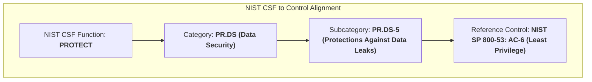

# 🛡️ Data Leak Prevention & Least Privilege Lab (NIST SP 800-53: AC-6)


---

## 📌 Executive Summary & Academic Provenance

This practical repository is derived directly from the **Google Cybersecurity Professional Certificate** (*Course 5: Assets, Threats, and Vulnerabilities*).

The project analyzes a real-world enterprise data leak at an educational technology organization where confidential internal product roadmaps and customer analytics were inadvertently shared with an external business partner and published on social media. 

The investigation and remediation plan follow the **National Institute of Standards and Technology Cybersecurity Framework (NIST CSF: PR.DS-5)** and **NIST Special Publication 800-53 (Control AC-6: Least Privilege)**.

---

## 🎯 Incident Breakdown: Vulnerability vs. Hardened State

| Factor | Vulnerable State (Pre-Audit) | Hardened State (NIST SP 800-53: AC-6) |
| :--- | :--- | :--- |
| **Access Granularity** | Broad parent folder access granted for meeting | Asset-level sharing only (specific file access) |
| **Permission Duration** | Persistent indefinite access (forgotten revocation) | Automated time-based access expiration (TTL links) |
| **Sharing Governance** | Relied entirely on verbal human warnings | Technical Role-Based Access Control (RBAC) & DLP policy |
| **External Link Control** | Unrestricted external link generation | Outbound parent-folder sharing blocked for sales reps |

---

## 🏛️ Control Hierarchy: NIST CSF to NIST SP 800-53



---

## 🧪 Hands-on Simulation Lab

A reproducible Python simulation engine ([`scripts/simulate_dlp_ac6_enforcement.py`](scripts/simulate_dlp_ac6_enforcement.py)) models the incident lifecycle:

```bash
# Execute the simulation lab
python3 scripts/simulate_dlp_ac6_enforcement.py
```

### Lab Telemetry Output:

```text
======================================================================
🚨 SCENARIO 1: VULNERABLE DATA SHARING (Manual Oversight / Unrestricted)
======================================================================
[*] Asset: 'New_Product_Launch_2026' (Parent Internal Folder)
[*] Control: Verbal Manager Warning ('Please do not share yet')

[+] Sales Manager shares full parent folder with sales rep...
    --> Residual Access Status: PERSISTENT (Indefinite Access).
[+] Sales Representative enters video call with external partner...
    ⚠️ MISTAKE: Representative accidentally copies parent folder URL instead!
    ⚠️ Outbound Sharing Policy: DISABLED (Unrestricted External Sharing).

🚨 [DATA LEAK CONFIRMED] External partner receives confidential folder link!
🚨 Partner posts link to public social media page. Confidential roadmaps exposed.
======================================================================

======================================================================
🛡️ SCENARIO 2: HARDENED DATA SHARING (NIST SP 800-53: AC-6 Controls)
======================================================================
[*] Control 1: Automated Time-Based Access Revocation (Expiring TTL Links)
[*] Control 2: Role-Based External Link Restriction (RBAC & DLP Policy)

[+] AC-6 Control: Granted access on 'New_Product_Launch_2026' to sales_rep_1.
    --> Automated Expiration (TTL): 1s from issuance.
[+] Sales rep attempts to share parent confidential folder with external partner...
    🛡️ Policy Enforcement: DLP VIOLATION: Role 'Sales_Representative' cannot share confidential parent folders externally.
[+] Meeting concludes. Waiting for automatic time-to-live (TTL) expiration...
[+] Sales rep attempts to re-access folder post-meeting...
    🛡️ Access Check: Access expired via automatic time-based revocation (NIST AC-6).
🛡️ [PROTECTED] Accidental data leak completely prevented by automated controls.
======================================================================
```

---

## 📂 Repository Layout

```
├── README.md                                             # Portfolio documentation & scenario breakdown
├── reports/
│   └── DATA_LEAK_PREVENTION_REPORT.md                   # Full audit report & worksheet responses
├── scripts/
│   └── simulate_dlp_ac6_enforcement.py                  # Automated simulation verifying AC-6 controls
└── docs/                                                 # NIST SP 800-53 AC-6 reference guidelines
```

---

## 👤 Author & Cybersecurity Portfolio

**Eduardo Souza Marques**  
- **GitHub:** [@edusouzamarques](https://github.com/edusouzamarques)  
- **Portfolio Showcase:** [edusouzamarques.github.io/cybersec](https://edusouzamarques.github.io/cybersec/)  
- **Certifications & Training:** Google Cybersecurity Professional Certificate, CompTIA Security+ SY0-701 Preparation
