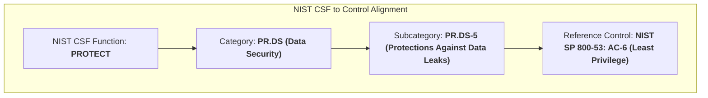
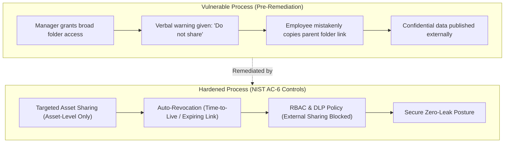

# 🛡️ Data Leak Incident & Least Privilege Governance Report (NIST SP 800-53: AC-6)

**Academic & Professional Provenance:** Google Cybersecurity Professional Certificate (Course 5: *Assets, Threats, and Vulnerabilities*)  
**Standard Frameworks:** NIST Cybersecurity Framework (PR.DS-5) / NIST SP 800-53 (Control AC-6: Least Privilege)  
**Lead Cybersecurity Analyst:** Eduardo Souza Marques ([@edusouzamarques](https://github.com/edusouzamarques))  
**Target Organization:** EdTech Automated Grading Platform  
**Incident Classification:** Confidential Data Leak / Accidental External Disclosure / Broken Access Control  
**Status:** Audit Completed, Remediations Formulated & Validated via Automated Simulation  

---

## 1. Executive Summary & Incident Overview

An educational technology company handling sensitive academic data from students, instructors, and educational institutions experienced an accidental data leak of unreleased business plans and customer analytics on social media. 

An internal security audit revealed that the leak was precipitated by failure to enforce the **Principle of Least Privilege (PoLP)** and reliance on informal verbal warnings rather than automated technical controls during internal document sharing.

---

## 2. NIST CSF & SP 800-53 Control Hierarchy

---

## 3. Incident Analysis (Data Leak Worksheet Breakdown)

### 📌 Incident Summary
A sales manager shared access to an entire internal-only Google Drive/cloud folder with the sales team during an internal meeting. The folder contained unannounced product roadmaps, customer usage analytics, and marketing promotional assets. After the meeting, the manager failed to revoke folder permissions, merely providing a verbal warning to the team to await authorization before distributing promotional materials.

During a subsequent videoconference with an external business partner, a sales representative intended to share only the promotional flyer link. By mistake, the representative copied and transmitted the URL of the **entire parent internal folder**. Believing the link was intended for public distribution, the partner published it to their official corporate social media account, publicly compromising confidential business plans.

---

### 🚨 Issues Identified
The data leak was caused by excessive access permissions and a lack of access revocation. The sales manager granted full folder access instead of sharing individual files, and failed to revoke access post-meeting. Subsequently, the representative lacked folder link-sharing restrictions and mistakenly shared the entire confidential internal directory externally.

---

### 📖 Review: NIST SP 800-53: AC-6 (Least Privilege)
NIST SP 800-53: AC-6 defines the Principle of Least Privilege, mandating that users only receive the minimal access necessary to perform authorized duties. It addresses preventing privilege creep by enforcing role-based access control, time-based automatic access revocation, maintaining user activity logging, and conducting periodic audits of provisioned permissions.

---

### 🛠️ Control Enhancement Recommendations

1. **Automatically Revoke Access to Information After a Period of Time:**  
   Implement automated expiring access links or time-based access control lists (Time-To-Live / TTL). Access provisioned to team members for specific collaboration meetings must automatically expire upon meeting conclusion, removing residual access rights.

2. **Restrict Access to Sensitive Resources Based on User Role (RBAC):**  
   Configure centralized Data Loss Prevention (DLP) and cloud document governance policies that restrict external sharing permissions. Non-administrative sales personnel should be technically prohibited from sharing parent internal folders with external domains, restricting outbound link generation strictly to approved marketing collateral.

---

### ⚖️ Technical Justification
Automatically revoking folder access ensures that permissions do not persist indefinitely due to human oversight. Restricting external sharing permissions via role-based access control prevents employees from inadvertently sharing sensitive parent directories with third parties. Together, these automated controls eliminate reliance on verbal warnings and significantly reduce the likelihood of accidental data leaks.
